# claude-accounts



Run several Claude Code accounts side by side, each in its own terminal, with a single shared setup.

No more `/logout` and `/login` every time you switch between your personal and work accounts. Pick an account and Claude starts. Your `CLAUDE.md`, skills, agents, plugins and settings come with it.

## Why

Claude Code keeps one login per configuration directory. Switching accounts means logging out and back in, and you cannot keep two accounts open at once.

claude-accounts gives each account its own directory and links the shared parts back to `~/.claude`. You configure Claude once and every account uses that configuration.

- Keep two accounts open at the same time, in two terminals.
- Share one `CLAUDE.md` and one set of skills, agents, commands, plugins and themes across all accounts, plus the MCP servers you add to any of them.
- Create a shared directory later and existing accounts pick it up on their next launch.
- claude-accounts never reads, copies or sends your credentials. It makes no network requests.
- One self-contained binary for Linux, macOS and Windows. Nothing else to install.

## Installation

You need [Claude Code](https://docs.anthropic.com/en/docs/claude-code) on your `PATH`.

**Linux and macOS.** Download the binary for your system from the latest release:

```sh
# x86_64-unknown-linux-gnu, aarch64-unknown-linux-gnu, x86_64-apple-darwin or aarch64-apple-darwin
target=x86_64-unknown-linux-gnu
curl -fLo "$HOME/.local/bin/claude-accounts" --create-dirs \
  "https://github.com/LouisStani/Claude-Accounts/releases/latest/download/claude-accounts-$target"
chmod +x "$HOME/.local/bin/claude-accounts"
claude-accounts --version
```

Make sure `~/.local/bin` is on your `PATH`. Run the same commands again to update.

**Windows** (PowerShell):

```powershell
$dir = "$env:LOCALAPPDATA\Programs\claude-accounts"
New-Item -ItemType Directory -Force $dir | Out-Null
Invoke-WebRequest -OutFile "$dir\claude-accounts.exe" `
  https://github.com/LouisStani/Claude-Accounts/releases/latest/download/claude-accounts-x86_64-pc-windows-msvc.exe
$userPath = [Environment]::GetEnvironmentVariable('Path', 'User')
[Environment]::SetEnvironmentVariable('Path', "$userPath;$dir", 'User')
```

Open a new terminal, then run `claude-accounts --version`. Windows support is new: it passes the automated tests but has not been used day to day yet. Please report any problem.

**From source**, with Rust installed:

```sh
cargo install --locked --git https://github.com/LouisStani/Claude-Accounts
```

**Upgrading from 1.x.** Version 2 reads the same files: your accounts work as they are. Replace the old `claude-accounts` script with the binary. Bash, `jq` and `gum` are no longer needed.

## Quick start

```sh
claude-accounts add personal
claude-accounts add work

claude-accounts run personal   # first launch: run /login inside Claude
```

Each later launch reuses the account you logged in with. Open a second terminal and run the other account at the same time:

```sh
claude-accounts run work
```

Or just run `claude-accounts` to open the menu. It shows whether each account is logged in, its plan and how many Claude sessions are open on it. Type to filter, use the arrow keys and Enter to launch, add or remove an account. Escape cancels.

## Commands

| Command | Effect |
| --- | --- |
| `claude-accounts` | Opens the menu and starts Claude in the current terminal. |
| `claude-accounts add <name>` | Creates an account and its private directory. |
| `claude-accounts list [--json]` | Prints account names, one per line. |
| `claude-accounts status [--json]` | Shows whether each account is logged in, its plan (`pro`, `max`…) and its active sessions. |
| `claude-accounts remove <name> [--delete-dir \| --keep-dir]` | Removes an account from the list. Its directory is deleted only after you confirm, or as the option says. |
| `claude-accounts run <name> [args]` | Starts Claude with this account. Extra arguments go to `claude`, for example `--resume`. |
| `claude-accounts isolate <name>` | Stops sharing MCP servers with and from this account. See [Isolated accounts](#isolated-accounts). |
| `claude-accounts unisolate <name>` | Shares MCP servers again from the next launch. |
| `claude-accounts isolated [--json]` | Lists isolated accounts. |
| `claude-accounts --version` | Prints the installed version. |

Names use 1 to 32 characters among `a-z`, `0-9`, `_` and `-`.

`add`, `list`, `remove` and `run` work without the menu, so you can use them in scripts and aliases:

```sh
alias cw='claude-accounts run work'
```

## Scripting

Other programs can drive claude-accounts through the commands below. Their output stays stable across all 1.x versions: new fields may be added, existing ones are not renamed or removed.

[claude-sessions](https://github.com/LouisStani/Claude-Sessions) uses them to show the Claude sessions of all your accounts side by side in one terminal, and to let them send each other messages.

| Command | Output |
| --- | --- |
| `list` | Account names only, one per line. Nothing on stdout when there are no accounts. |
| `list --json` | `["personal","work"]`, or `[]` |
| `status --json` | An array of accounts, see below. `[]` when there are no accounts. |
| `remove <name> --delete-dir` | Removes the account and deletes its directory, without asking. |
| `remove <name> --keep-dir` | Removes the account and keeps its directory, without asking. |
| `run <name> [args]` | Replaces itself with `claude` running on this account. |
| `isolated --json` | `["work"]`, or `[]` |
| `--version` | `claude-accounts 2.0.0` |

```json
[
  {"name": "personal", "state": "logged-in", "sessions": 1, "plan": "pro", "dir": "/home/me/.local/share/claude-accounts/personal", "isolated": false},
  {"name": "work", "state": "logged-out", "sessions": 0, "plan": null, "dir": "/home/me/.local/share/claude-accounts/work", "isolated": true}
]
```

- `state` is `logged-in`, `logged-out` or `unknown` (Claude Code did not answer).
- `sessions` is the number of running Claude sessions on the account.
- `plan` is the subscription type reported by Claude Code, or `null`.
- `dir` is the account's `CLAUDE_CONFIG_DIR`.
- `isolated` is `true` for an isolated account (since 1.2.0).

On error, the exit code is not 0 and stderr explains why: one line starting with `claude-accounts:`, or the usage text for an unknown command or option. `jq` is not needed.

## How it works

Each account gets its own `CLAUDE_CONFIG_DIR`.

| Data | Where it lives |
| --- | --- |
| Credentials, sessions, history, project memory | Private to each account |
| `CLAUDE.md`, `skills/`, `agents/`, `commands/`, `plugins/`, `themes/` | Symbolic links to `~/.claude` (see Windows below) |
| `settings.json` | Read from `~/.claude/settings.json` and passed with `--settings` |
| MCP servers of the other accounts | Merged at launch and passed with `--mcp-config` |

Links are checked on every launch. On Linux and macOS, account directories use `700` permissions and the account list uses `600`.

On Windows, a symbolic link needs developer mode. Without it, folders are shared through junctions and `CLAUDE.md` is copied, then refreshed from `~/.claude` at each launch. If you edit that copy inside an account, it is no longer refreshed and claude-accounts warns you: copy your changes to `~/.claude/CLAUDE.md`. Accounts live in `%APPDATA%\claude-accounts`.

## Shared MCP servers

Add an MCP server once, in any account, with the user scope:

```sh
claude mcp add -s user --transport http sentry https://mcp.sentry.dev/mcp
```

Every other account gets it on its next launch. Remove it from the account where you added it and it disappears everywhere on the next launch.

At each launch, claude-accounts reads the `mcpServers` of the other accounts, merges them into its own file and passes it with `--mcp-config`. It never writes to Claude Code's files.

- A server name the launched account already defines, at any scope, is not passed: the account keeps its own server and its own authentication.
- If two other accounts define the same name, the first account in `claude-accounts list` wins.
- If an account's `.claude.json` cannot be read, that account is skipped with a warning. If the launched account's own file cannot be read, Claude starts without shared servers.
- Headers and environment variables of a server, API keys included, become available to every account. Isolate an account to keep it out of this.

## Isolated accounts

Keep a work account apart from your personal ones:

```sh
claude-accounts isolate work
```

An isolated account gives its MCP servers to no other account and receives none from them. Its own servers, added in that account, still work. It keeps the shared `CLAUDE.md`, skills, agents, commands, plugins, themes and settings.

Isolation applies from the next launch. Sessions already running keep the servers they loaded: restart them, on the isolated account and on the others.

[claude-sessions](https://github.com/LouisStani/Claude-Sessions) also keeps isolated accounts out of its messages between sessions.

## Security and billing

Before starting Claude Code, claude-accounts removes these environment variables:

```text
ANTHROPIC_API_KEY
ANTHROPIC_AUTH_TOKEN
CLAUDE_CODE_OAUTH_TOKEN
```

A key or token exported in your shell therefore cannot override the account you picked, and you are billed on the account you chose.

Login status comes from `claude auth status`, run with the same variables removed. Claude Code reads its own credentials locally; claude-accounts only reads the exit code and the plan name.

Active sessions are counted from the `sessions/` directory of each account, keeping only the processes that are still running `claude`. This directory is internal to Claude Code: if its layout changes, the count disappears and nothing else breaks.

## Development

The tests never touch a real Claude account. They run in a temporary `HOME` with a fake `claude` executable.

```sh
cargo test
cargo clippy --all-targets
cargo build --release && ./tests.sh   # Linux: the full command-line contract
```

On macOS and Windows, the CI runs `ci/smoke.sh` and `ci/smoke.ps1` instead of `tests.sh`, which needs GNU tools.

Read [CONTRIBUTING.md](CONTRIBUTING.md) before contributing and [SECURITY.md](SECURITY.md) to report a vulnerability.

## License

Since version 1.2.1, claude-accounts is licensed under [CC BY-NC-SA 4.0](LICENSE). You can use, change and share it for non-commercial purposes, if you credit the author and share your changes under the same license.

Commercial use, including use inside a company, is not allowed by this license. To ask for it, open an issue. Versions up to 1.2.0 were released under the Apache License 2.0 and keep that license.
